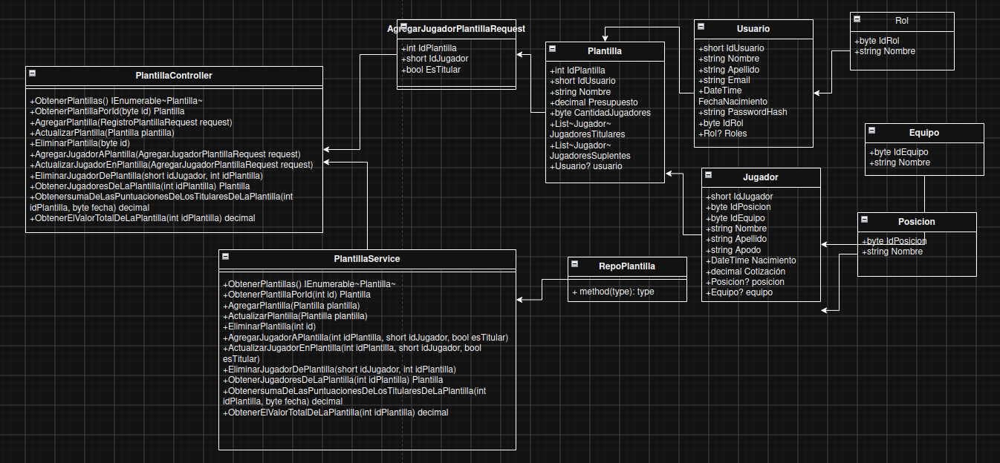
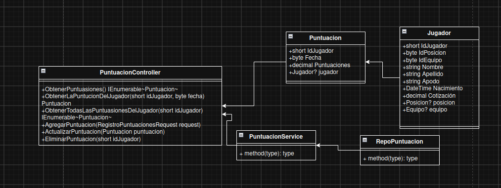

# Punto de partida

agregar un diagrama de secuencia del proceso

Actividad 1:

# caso 1: Agregar jugadores a la platilla del usuario

Al agregar un jugador a mi plantilla, lo que se toma del jugador es su ID y se tiene en cuenta su "IdPosicion" para verificar que la plantilla a un tiene espacios para jugadores de esa posición, también la plantilla en su lógica de negocio verificará que aún haya espacios para titulares en caso de que lo quiera agregar como titular, si no verificará que aún quede espacio para jugadores suplentes y verificará que la plantilla tenga el dinero para agregar el jugador .

un lugar en donde puede salir mal, es en la base de datos porque puede que no exita el jugador o la plantilla .

un lugar en donde puede salir mal, es en el service de plantilla porque puede que no haya espacio para jugadores titulares o en general y que no tenga el presupuesto para agregar al jugado.

# Caso 2: el usuario quiere ver la puntuación del jugador en una fecha específica

Para que el usuario pueda ver la puntuación de un jugador en una fecha específica, tiene que tener en cuenta el id del jugador y una la fecha para poder verla puntuación.

un lugar en donde puede salir mal, es en la base de datos porque puede que no exita el jugador o en la fecha el jugador no haya jugado.

un lugar en donde puede salir mal, es en el service de plantilla porque puede que la fecha no exita.

